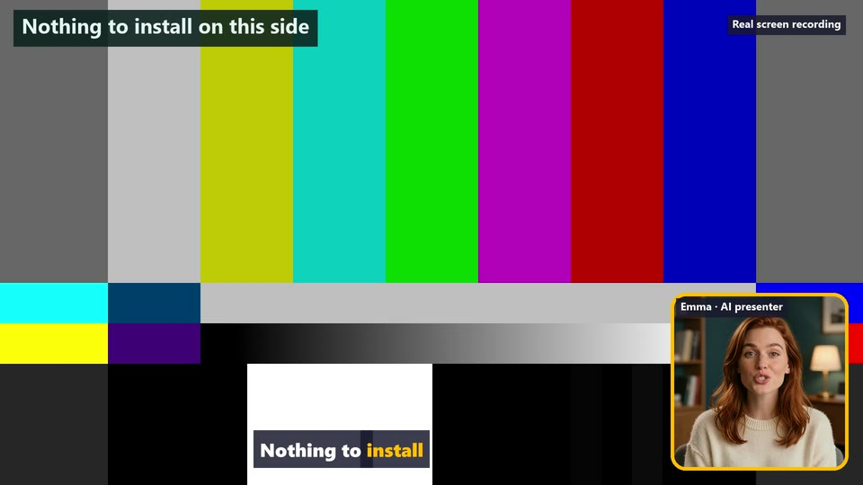
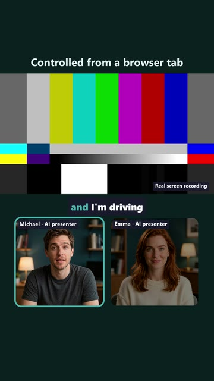
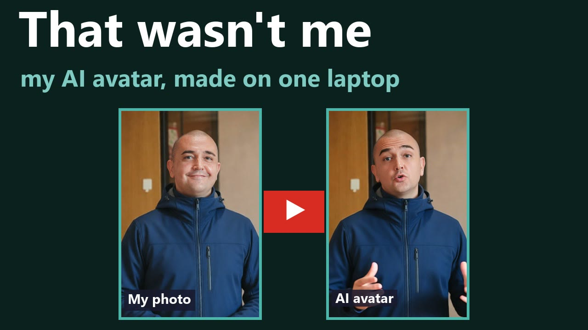
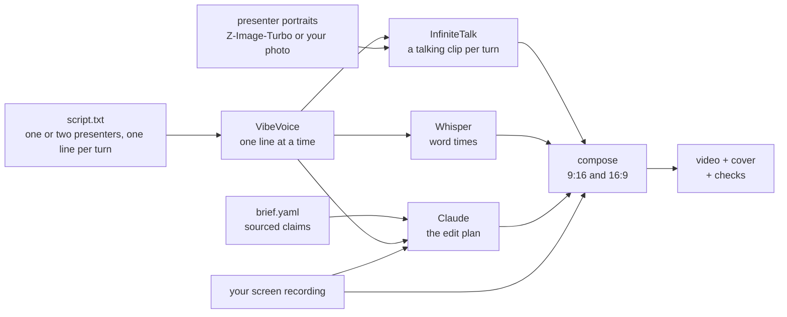

# roomler-ai-avatar

AI presenters beside a real screen recording, made on your own GPU.

You bring a short script for one or two presenters, a brief with the claims the video may make, and a
screen recording of your product. The tools render the voices, the presenters' talking faces and
word-by-word captions, let Claude plan the edit, and put it all together as a vertical 9:16 and a 16:9
video, with the AI disclosure in the picture from the first frame. This is a local, open-weights take on
what services like HeyGen, Creatify and Zeely sell, built for one job: product videos where the
presenters are hosts and the real recording is the proof.

<p align="center">
  
  <br>
  <i>The example's two formats. The test pattern stands in for your screen recording.</i>
</p>

<p align="center">
  <a href="https://youtu.be/eTX3KQ3Ogys"></a><br>
  <i><a href="https://youtu.be/eTX3KQ3Ogys">How these videos are made</a> (3 min, YouTube), presented by two AI avatars of Goran in his cloned voice. Its script is in <a href="videos/avatar-making-of/"><code>videos/avatar-making-of/</code></a>.</i>
</p>



## Used by Roomler

[Roomler](https://roomler.ai) makes its product videos with this toolkit, which is why it exists.
Roomler is one open-source product that does the work of three: it puts the desktop of any machine you
own into a browser tab, joins your machines into a private WireGuard mesh, and adds team chat and video
calls on top, all from one daemon and one web app. The stream between two machines is end-to-end
encrypted; the server introduces the two ends and never sees the pixels, keystrokes or files. It is
self-hostable with unlimited devices. If you look after machines in more than one place, have a look at
[github.com/gjovanov/roomler-ai](https://github.com/gjovanov/roomler-ai).

The two presenters here, Michael and Emma, are the hosts of Roomler's videos. They are invented people:
their faces come from a text prompt, and their voices from a text-to-speech model. In some videos Goran,
who maintains Roomler, presents it himself as an AI avatar made from his own photos, with his consent:
his portraits are in [`presenters/`](presenters/), and his voice prompt is not
([docs/real-person.md](docs/real-person.md)).

## What it does

| Step | Tool | Model | Runs on |
|---|---|---|---|
| The narration, one line at a time, checked by Whisper | `tools/voice/lines.ts` | VibeVoice-1.5B (MIT) via [starling's podcast-server](https://github.com/gjovanov/starling/tree/master/apps/podcast-server) | GPU |
| Every line's pitch and pace, against its speaker | `tools/voice/pitch.ts` | | CPU |
| The audio at -14 LUFS, with an optional music bed that dips under speech | `tools/voice/mix.ts` | | CPU |
| The same narration a little deeper, every time kept | `tools/voice/retune.ts` | rubberband | CPU |
| Word times for the captions, one turn at a time | `tools/avatar/words.ts` | Whisper medium.en (MIT) | GPU or CPU |
| A presenter's face: invented, or from your own photo | `tools/avatar/portrait.ts` | Z-Image-Turbo, Qwen-Image-Edit-2511 (Apache-2.0) | GPU |
| The edit plan: a layout per turn, cards that cite your claims, hook variants, a cover | `tools/avatar/storyboard.ts` | **Claude**, through Claude Code | Anthropic |
| A talking clip per turn (or per block of one presenter's lines), cut in the silence between them | `tools/avatar/talk.ts` | InfiniteTalk on Wan2.1-I2V-14B (Apache-2.0) | GPU |
| The 9:16 and the 16:9 (a corner bubble, or a tutor beside the screen), captions, cards and disclosure | `tools/avatar/compose.ts`, `compose16.ts` | | CPU |
| A thumbnail | `tools/avatar/cover.ts` | | CPU |
| A studio conversation (a podcast): listening clips, every presenter's clips chained so no cut jumps, two cameras with cards and demos full frame, the cuts measured | `tools/podcast/` (`chain.ts`, `listen.ts`, `compose.ts`, `seams.ts`) | InfiniteTalk | GPU, then CPU |
| Every narration line read back against the script, and the doubtful ones re-voiced by measurement | `tools/voice/qa-lines.ts`, `tools/voice/fix-lines.ts` | Whisper, VibeVoice | GPU |
| Cards, titles and diagrams from HTML pages | `tools/avatar/html-frames.ts` | chrome-headless-shell | CPU |
| Specs, loudness, and what the recording must not show | `tools/check.ts` | tesseract (optional) | CPU |
| A share copy for review | `tools/share.ts` | | CPU |

Claude is the only LLM in the pipeline, and it writes no word of the narration: it plans what the viewer
sees.
The models run locally through [ComfyUI](https://github.com/comfyanonymous/ComfyUI), headless, driven
over its HTTP API by the bun scripts here. [docs/models.md](docs/models.md) has every model, its
licence and its role.

## Quick start

On a machine that is already set up ([docs/setup.md](docs/setup.md)), the example in
[`example/`](example/) makes a 20 s video about Roomler in both formats:

```bash
bun tools/voice/lines.ts render example/script.txt example/out/narration      # the voices
bun tools/voice/mix.ts example/out/narration                                    # the audio
bun tools/avatar/words.ts example/out/narration --out example/out/words.json    # caption timing
# ...the screen recording, the plan, the talking clips and the compose: example/README.md
```

[example/README.md](example/README.md) walks through every command, and
[docs/run.md](docs/run.md) explains each step and its options for your own video.

## Requirements

- An NVIDIA GPU with 24 GB of VRAM (tested on an RTX 5090 Laptop GPU; less may work with more
  `--swap`, slower and untested), and 32 GB of RAM or more.
- Windows 11 with WSL2 (tested), or Linux. The GPU side runs on Linux; the tools run on either side.
- About 75 GB of disk: 54 GB of model weights (84 GB with the optional photo-to-portrait model), plus the voice engine and the virtual environments.
- [bun](https://bun.sh), ffmpeg (with libass, libx264 and librubberband), and
  [Claude Code](https://docs.claude.com/en/docs/claude-code) logged in, for the plan.

## What to expect

A 75-second two-host video takes one to two hours of GPU time for its talking clips (a 125-second
one-presenter video took 84 minutes), a few minutes for everything else, and a person's judgement at
three points: the voice takes, the faces, and the final cut. Lip sync is tight, the presenters blink and
move their heads, and identity holds through a clip; a presenter whose portrait shows the hands
gestures with them.
Some voice takes come out wrong (an octave up, mumbled, rushed) and are measured and rendered again.
[docs/expectations.md](docs/expectations.md) has the measured numbers, the quality you get, and every
trap we hit, including the one that crashed a laptop.

## Docs

- [docs/setup.md](docs/setup.md): install and configure, step by step
- [docs/run.md](docs/run.md): make a video, step by step
- [docs/how-it-works.md](docs/how-it-works.md): the pipeline, the segments, the layouts, the caching
- [docs/models.md](docs/models.md): the LLM and the models, with licences
- [docs/expectations.md](docs/expectations.md): time, quality, hardware, failure modes
- [docs/real-person.md](docs/real-person.md): your own face and voice, consent, and disclosure
- [`.claude/skills/avatar-video`](.claude/skills/avatar-video/SKILL.md): a Claude Code skill that drives
  the whole process, from the script to the checks, in both formats; the studio conversation format is
  in its [`references/podcast.md`](.claude/skills/avatar-video/references/podcast.md)
- [`.claude/skills/demo-first-scriptwriter`](.claude/skills/demo-first-scriptwriter/SKILL.md): a Claude
  Code skill that writes a one-presenter product demo: the proof on screen first, the explanation after,
  every claim scoped to its evidence
- [`videos/`](videos/): the script and the brief of real videos made with it

## Rules this tool is built around

- **The recording is the proof; the presenters are hosts.** The tools never generate product footage or
  UI. Never cast a presenter as a customer or a user: an AI testimonial is misleading, and banned
  outright in some places (the US FTC's 16 CFR 465).
- **Disclosure is in the picture from the first frame.** Every presenter's label says "AI presenter"
  (or "AI avatar" for a real person's likeness), and the recording says it is real. The EU AI Act's
  Art. 50 asks for a visible label at first exposure; set the platforms' own AI flags as well.
- **A real person's face or voice needs their recorded consent.** Their voice prompt never goes into a
  repository, and their face only when they have agreed to publish it
  ([docs/real-person.md](docs/real-person.md)).

## Licence

Apache-2.0, see [LICENSE](LICENSE) and [NOTICE](NOTICE). The models and programs the tools drive keep
their own licences ([docs/models.md](docs/models.md)); VibeVoice's model card states a research
purpose, and whether to publish its audio commercially is your call.
