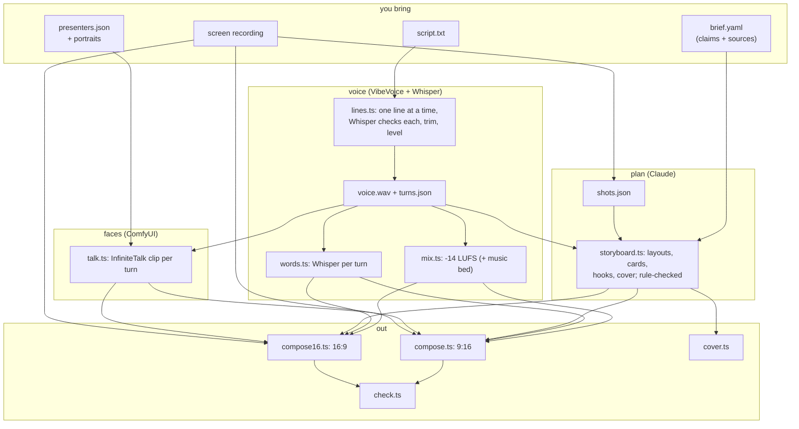
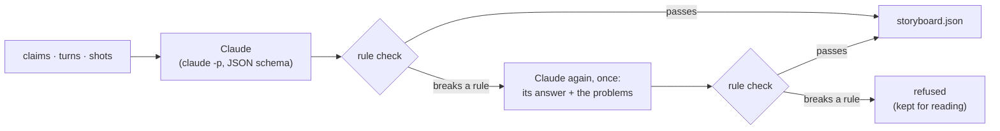

# How it works

## The idea

A presenter video has two jobs: a person who talks to the viewer, and proof that the product does what
they say. Generated video is good at the first and bad at the second, so this pipeline splits them. The
presenters are generated, and labelled as AI from the first frame. The product is only ever a real
screen recording, at real speed. Claude plans the edit between the two: which turn shows the recording,
which turn is a reaction, and which claim each on-screen card states.

## The pipeline



## The narration, one line at a time

VibeVoice can render a whole two-person dialogue in one pass, and that is what it is designed for. In a
promo it fails at the hand-overs: the last syllable of a speaker gets clipped, and the gaps carry a
faint pitched noise. So `lines.ts` renders each line alone. A line rendered alone ends where its speech
ends; the tool trims it by energy (60 ms before the first sound, 220 ms after the last, so a word's
decay is never cut), levels it to the same speech loudness as the others, and joins the lines with
digital silence of a length you choose. The turn times in `turns.json` are then exact by construction,
and every later step keys off them.

Whisper listens to every line on its own. A line where it hears less than 60% of the words stops the
run: VibeVoice occasionally mumbles a take, and a mumbled take costs GPU minutes downstream.

## Segments: every cut lands in silence

```text
seconds   0         5    6    8    9              14   15
speech    [michael 0 ]    [emma]    [ michael 2     ]
clips     [ clip 0     ][ clip 1 ][ clip 2            ]
                       ^5.5      ^8.5
                 each cut in the middle of a silence
```

`talk.ts` cuts the narration into one segment per turn, from the middle of the silence before the turn
to the middle of the silence after it (`lib.segments`). The segments tile the timeline with no gap and
no overlap, and every cut between two presenters lands in silence, so a presenter's reset to their
portrait pose at the start of a clip is hidden by the cut. Each segment's audio drives one InfiniteTalk
clip of that speaker.

With one presenter there is no other face to cut to, and a cut on every line shows: the hands drop back
to the portrait's pose at every sentence. `--group-gap 1.0` makes one segment of each run of one
speaker's lines with less than a second between them, so a block of the script (lines that end on a
longer pause, `lines.ts --pause`) is one continuous clip. The 23 lines of
[videos/wayland-asahi](../videos/wayland-asahi/script.txt) render as six clips of 16-27 s, one per thing
the recording shows, and each cut lands in a pause where the picture changes anyway. A clip has one
layout, so the plan gets the same `--group-gap` and gives a block's turns one layout; the compose
refuses a clip whose turns were planned to show different things rather than follow its first turn.

## The talking clip

InfiniteTalk is an audio-driven video model on Wan2.1-I2V-14B: a portrait plus speech gives a video of
that person saying it, with lip sync, head movement and blinks. It generates in 81-frame windows (3.24 s
at 25 fps) that hand nine frames of motion to the next window, so a clip can be any length. The
lightx2v step-distillation LoRA brings it to 6 sampling steps at guidance 1.

`workflows.ts` builds the ComfyUI graph as code (API format), so a change is a reviewable diff, not a UI
graph. `comfy.ts` queues it over ComfyUI's HTTP API and waits.

Every clip is cached by a hash of what shapes it: the portrait, the audio window, the prompt, the seed
and the sampler settings. That makes three things cheap:

- **A re-run** renders only the segments that changed.
- **Re-voicing one presenter** (`--reuse old/talk.json`) keeps the other presenter's clips. A reused turn
  keeps its old window around its speech (`lib.pinnedSegments`), and the turns around it absorb the
  difference, so the reused clip still matches its audio sample for sample.
- **Several editions** (`--clips shared/`) find each other's clips. Three editions of one narration with
  three faces in different combinations rendered the third edition with no GPU work at all.

The text prompt of every presenter is encoded first, alone, into the node pack's disk cache: the text
encoder is 11 GB, and loading it beside the 14B model once ran a WSL VM out of memory. Before each clip
the server unloads every model: a model left on the GPU from the clip before is still there while the
next one loads, and that overflowed a 24 GB card into the host's memory.

## The plan

`storyboard.ts` gives Claude the claims, the timed turns and the shots, and asks for one JSON object
(a schema enforces its shape): a layout for every turn, the cards, three hook variants and a cover. The
run has no tools at all; it reads and answers.



The rules are checked in code, not trusted to the model: one beat per turn; the first turn shows the
recording; at most three solo turns, never two in a row, never longer than about three seconds of
speech; every turn after the recording ends is an end card and none before; cards of at most six words
and 32 characters, without dashes, inside the recording, not overlapping, each citing a claim, the
first one at zero; a cover of at most 28 characters. A plan that breaks one goes back to Claude once,
with its own answer and the check's words for what is wrong, because a model miscounts now and then (a
seven-word card read as six) and a fresh plan for one long card would be a different plan, not a fix.
The reply is checked the same way. A plan that still breaks a rule is refused, never patched quietly.

## The layouts

**16:9.** The recording fills the frame at its own pixels, so text in it stays readable. The speaking
presenter sits in a rounded bubble at the bottom right, ringed in their colour. There is no listener:
the frame belongs to the recording. A solo turn puts the speaker in a large centred tile; the end card
puts the title and subtitle above the speaker's bubble.

**16:9, tutor** (`--layout tutor`). A presenter who gestures needs room for the hands, and a bubble
crops them away. Here the recording sits on the left at 1152x648 (60% of the width), the cards above it
and the captions below it, and the presenter fills a tall panel on the right, 1000 px high, for the
whole video, like a teacher beside a screen. A solo turn hides the recording and shows its card large
in that place, as a chapter title; the end card takes its place at the end. A title longer than that
space is drawn smaller until it fits: its width is measured, not guessed from its length, so "Make
your own avatar" no longer runs under the presenter.

**A demo that owns the frame** (both 16:9 layouts). A `screen` turn shows the recording full frame with
no presenter at all, and its clip is never rendered, so the important moments of a demo play
undisturbed and the presenters come back between them. The storyboard can set each face's label
(`labels`, where an empty one draws none: disclose on the platform instead) and the chip that says what
the recording area shows (`chip`, per beat or for the whole video): "Real screen recording" by default,
and empty for a beat whose picture is a diagram or a still, which is not one.

```text
+--------------------------------------+---------------+
| card                                 | Goran · AI    |
| +----------------------------------+ | avatar        |
| |              Real screen rec.    | |               |
| |   the recording, 1152x648        | |  the          |
| |                                  | |  presenter,   |
| +----------------------------------+ |  waist up,    |
|              captions                |  hands in it  |
+--------------------------------------+---------------+
```

**9:16.** The recording sits at the top of the platforms' safe zone (1080x608 at y 370), the captions
below it, and the two presenters as video-call tiles below those. The speaker's tile is lit and ringed;
the listener's is dimmed. The listener is a still of their portrait by default: an idle clip,
InfiniteTalk driven by silence, keeps the mouth busy anyway and looks wrong on a real face.

In both, a card shows over the recording (in the tutor layout a solo turn shows it large, as a title;
never over an end turn), and the captions show up to three words a page, the word being said in its
speaker's colour.

## Captions

`words.ts` has Whisper transcribe each turn on its own. Over a whole track Whisper runs long-form, and
there it drops lines and loops on pauses (one 72 s track came back with "We live!" 29 times over a
1.6 s pause). Per turn, every line is heard.

The captions then show the script's own words at Whisper's times (`lib.wordTimes`): the two word lists
are aligned as sequences (an exact match scores 2, a near miss 1, a skip -1), a word Whisper missed
gets the time between its heard neighbours by its length, and every word stays inside its turn. A
misheard brand name costs nothing; it is never what the viewer reads.

## Disclosure

Every presenter carries a label from the first frame: "Michael · AI presenter", or "AI avatar" for a
real person's likeness (`ai_label` in the registry). On a split turn the recording carries "Real screen
recording". This is in the picture on purpose: a platform's AI flag can be stripped by a re-upload, and
the EU AI Act's Art. 50 asks for a visible label at first exposure. Set the platforms' flags too.

## Robustness

Long GPU jobs on a desktop machine fail in ordinary ways, and the tools were changed each time one did:

| What happened | What the tools do now |
|---|---|
| The laptop slept for two hours mid-render; the server finished, the client died | `comfy.ts` keeps polling for ten minutes through refused connections |
| ComfyUI's default cache evicted the loaded model after every clip | the server runs with `--cache-classic` |
| The 14B model was re-read over WSL's 9p bridge for every clip (12-20 min) | weights on ext4; `setup.sh localize` for weights on a Windows drive |
| The text encoder loading beside the model ran WSL out of memory | prompts are encoded first, alone; the server runs in a 26 GB memory cap |
| A clip boundary overflowed the GPU by 5 GB into Windows' memory; with Windows already paging, the GPU timed out and the machine reset | the server unloads models before each clip; a run stops when the host has under 6 GB available |
| AAC pushed a sharp opening syllable past -1 dBTP | the compose measures the final file and limits only when needed |
