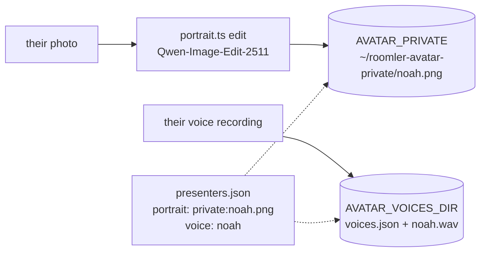

# A real person as a presenter

The tools can put a real person's face and voice in place of an invented presenter: yours, or someone's
who has agreed to it. This page is about doing that without leaking either, and without misleading
anyone.

## Consent first

- Only with that person's explicit, recorded consent, for this use. Record who agreed, when, and to
  what, in the presenter's `consent` field. A face or a voice of someone who has not agreed is never
  rendered, whatever the purpose.
- VibeVoice's model card rules out voice impersonation without explicit, recorded consent. Platforms
  and laws increasingly treat a synthetic likeness of a real person as that person speaking (New York's
  synthetic-performer law, the EU AI Act's deep-fake disclosure in Art. 50(4)).
- The person sees the video before anyone else does, and can pull it.

## Keep the face and the voice out of every repository



- **The portrait** is `"portrait": "private:<file>"` in the registry. The `private:` prefix resolves to
  `AVATAR_PRIVATE` (default `~/roomler-avatar-private`), outside the repository. `portrait.ts pick`
  writes there.
- **The voice** prompt lives in a folder of your own on the Linux side, pointed at by
  `AVATAR_VOICES_DIR` (in `~/.config/roomler-avatar/env`): a `voices.json` naming each voice, and a
  `.wav` of 10-20 seconds of the person reading plain text in a quiet room. Keep it readable only by
  you (`chmod 600`). That folder then holds every voice the scripts may use, so copy `michael.wav` and
  `emma.wav` (and their `voices.json` entries) in from the podcast-server if you want them beside it.
- **The registry entry** can be in the repository (it holds paths and prompts, not the face), or in a
  registry of your own (`AVATAR_PRESENTERS`).

```json
"noah": {
  "label": "Noah",
  "ai_label": "AI avatar",
  "real_person": true,
  "consent": "Noah Smith, 2026-10-20, recorded in ...: his face and voice for product videos",
  "voice": "noah",
  "ring": "#4db6ac",
  "portrait": "private:noah.png",
  "portrait_prompt": "Replace the background with a calm studio ...; keep the man exactly as he is",
  "talk_prompt": "A man is talking to the camera ... The camera stays still and the room behind him stays still."
}
```

## The portrait from a photo

```bash
bun tools/avatar/portrait.ts edit noah --from photo.jpg --seeds 21,22,23,24        # re-framed, square
bun tools/avatar/portrait.ts edit noah --from photo.jpg --seeds 31 --keep-framing \
  --prompt "Replace the background with ...; keep the man exactly as he is"         # his own framing, a new room
bun tools/avatar/portrait.ts pick noah 31 --keep                                    # -> AVATAR_PRIVATE/noah.png
```

Qwen-Image-Edit-2511 keeps the identity of the reference photo while it changes the framing or the room.
Let the person pick their own portrait: it is their face. A photo that is already a good head-and-
shoulders shot can be used as it is: crop it square and put it in the private folder.

Several pictures of one person are several presenters with the same `voice`. `talk.ts --face
noah=noah-studio,noah-garden` shows the voice with one of them, or rotates them through the turns.

## The voice

A clone from a short sample is as good as the sample. Read plain text, in a quiet room, at the pace you
want to sound like, close to the microphone. A sample recorded in a reverberant room comes back sounding
like it was spoken down a tunnel, and a person hears that in their own voice at once.

## What looks wrong on a real face

- **An idle clip.** InfiniteTalk driven by silence keeps the mouth busy anyway: chewing, squinting. On
  an invented face it passes as listening; on a real one the person will tell you it looks unnatural.
  The 16:9 shows only the speaker, and the 9:16's default listener is a still.
- **A selfie with an arm reaching out.** It works, but the arm never moves, and a solo tile shows it
  large.
- **A busy background.** The prompt asks for a still background, and it mostly holds; a plain one holds
  best.

## Disclosure

The label reads "AI avatar" (`ai_label`), and it is on screen from the first frame like every other
label. In the post's text, say that the face and voice are an AI likeness of the person, made with their
consent. Set the platforms' AI flags. Never present the avatar as the person speaking live, and never
use it to make the person say something they have not approved word for word.
