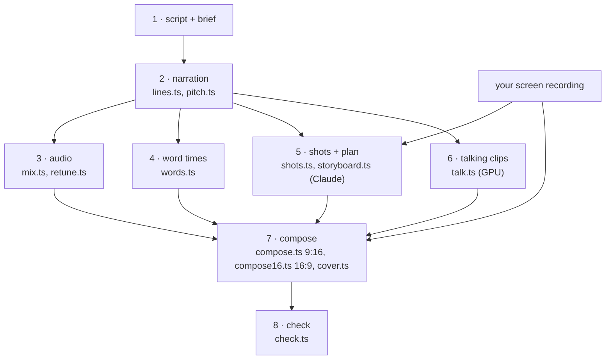

# Make a video

Eight steps, from a script to a checked video in two formats. Each tool prints what it did, and each
step's output is the next one's input, so you can stop, look, and run a step again. Paths below use an
`out/` folder; any folder works.



## 1. The script and the brief

The script is one turn per line, `speaker: text`, where a speaker is a voice the engine has
(`bash tools/voice/render.sh voices`). Lines starting with `#` are comments.

```text
michael: This desktop is in another city, and I'm driving it from a browser tab.
emma: Nothing to install on this side?
```

What works on screen, from the videos made with it:
- **Short turns, real conversation.** A turn of one or two sentences; the other presenter reacts.
- **Say it the way a person would.** VibeVoice reads what is written: "56 frames a second" reads better
  than "56fps".
- **End a short line with a full stop, not an exclamation mark,** when it comes out pitched (step 2).
- **A very short line can come out rushed.** Six or seven words rendered in a second and a quarter
  sound cut off; see step 2's fix.

**One presenter, explaining.** A single presenter works too. Write the script in blocks, one block per
thing the recording shows, and end each block on a longer pause (`lines.ts --pause n:1.2`); step 6's
`--group-gap` then renders each block as one continuous clip, so the presenter's gestures carry through
a block instead of resetting at every line. The
[demo-first-scriptwriter skill](../.claude/skills/demo-first-scriptwriter/SKILL.md) writes this kind of
script with you, and [videos/wayland-asahi/](../videos/wayland-asahi/) is one, with its brief.

The brief (`brief.yaml`) names the product and lists the claims the video may make, each with a source.
The plan cites a claim for every card on screen, so a claim you cannot source has no business being
there. [example/brief.yaml](../example/brief.yaml) shows the format.

The [Claude Code skill](../.claude/skills/avatar-video/SKILL.md) can draft the script from a brief with
you; the tools never write a spoken word.

## 2. The narration

```bash
bun tools/voice/lines.ts render script.txt out/narration
bun tools/voice/pitch.ts out/narration
```

`lines.ts` renders each line on its own with VibeVoice, has Whisper listen to it (a line where less than
60% of the words are heard stops the run), trims it to its speech, levels it, and assembles the lines
with clean silence between them. It writes `voice.wav` (-16 LUFS), `turns.json` (who speaks when),
`timings.json`, `captions.srt` and `lines.json` (where each line came from). Clips are kept, so a second
run only renders what is missing or asked for.

| Option | Default | Use |
|---|---|---|
| `--only 3,5` | | render these lines again (with this run's `--seed`) |
| `--seed 47` | 42 | another take of a line |
| `--use 3=take.wav` | | put a take you picked in line 3's place |
| `--pause 3:1.3` | | 1.3 s of silence after line 3 (a beat, a punchline) |
| `--between 0.8`, `--same 0.45` | | silence at a change of speaker, between one speaker's lines |
| `--cfg 1.8`, `--steps 10` | | VibeVoice's guidance and diffusion steps |
| `--no-ai-check` | | skip the AI-writing check (it runs only when the avoid-ai-writing Claude Code plugin is installed) |

**Listen to every line.** `pitch.ts` measures what an ear notices first. It flags a line more than four
semitones from its speaker's median (VibeVoice once rendered a line an octave up: 250 Hz from a voice at
124 Hz) and a line faster than five words a second. Re-render a flagged line with another seed, and with
"." in place of "!" if it was pitched up.

**A short line that sounds cut off:** render it with a word after it ("The typos arrive in real time,
too. Yes!"), cut the take in the silence before that word with ffmpeg, put it back with `--use`, and give
it a pause after with `--pause`. That took a 1.25 s line to 2.04 s.

## 3. The audio

```bash
bun tools/voice/mix.ts out/narration                                   # the voice alone
bun tools/voice/mix.ts out/narration --music track.mp3 --music-start 30 # over a music bed
```

Writes `out/narration/mix.wav` at -14 LUFS with a -2 dBTP ceiling, one second longer than the voice. A
music bed sits at -24.5 LUFS between turns and 7 dB lower under each one (`--bed-lufs`, `--duck`). Use
music you are licensed to publish.

**The same voice, a little deeper:**

```bash
bun tools/voice/retune.ts out/narration out/narration-deep --st -1.5    # --formant preserved: the pitch alone
bun tools/voice/mix.ts out/narration-deep --music track.mp3 --music-start 30
```

rubberband lowers the pitch and keeps the length to the sample, so the turns, the word times, the plan
and the talking clips of the original all still fit: compose the new `mix.wav` with the original's
`talk.json` and words. `retune.json` records the shift it measured (-1.5 asked, -1.3 measured on a male
voice).

## 4. Word times

```bash
bun tools/avatar/words.ts out/narration --out out/words.json
```

Whisper (medium.en by default, on the GPU) transcribes each turn on its own. The captions show the
script's words at Whisper's times, so a misheard name never reaches the screen. With the render running
on the GPU, use `--model openai/whisper-base.en --cpu`. Several lists can be merged turn by turn:
`--words a.json,b.json` in step 7.

## 5. The recording, the shots and the plan

The screen recording plays on the narration's timeline: it starts when the narration starts. Any size
works; it is scaled to fit. Record the product doing what the script says, at real speed. Where the
recording ends, the rest of the video gets the end card.

```bash
bun tools/avatar/shots.ts init out/narration recording.mp4 --out out/shots.json --what "..."
```

Then edit `out/shots.json`: split it where the picture changes subject, and say what each part shows, as
you would to an editor. Claude plans the cards against these descriptions.

```bash
bun tools/avatar/storyboard.ts --brief brief.yaml --narration out/narration --shots out/shots.json --out out/storyboard.json
```

One headless Claude run (Opus by default, `--model sonnet` for a cheaper one; `--effort`, `--style
rules.md` for your own writing rules) returns:
- a layout for every turn: `split` (the recording and the speaker), `solo` (the speaker large, for a
  short punchline) or `end` (the end card, for turns after the recording);
- the cards: at most six words each, timed to the recording, every one citing a claim of the brief;
- three alternative opening lines for an A/B test, and a cover text and face.

The answer is checked rule by rule (no solo first turn, no two solos in a row, cards inside the
recording and not overlapping, each one citing a claim, and so on). A plan that breaks a rule goes back
to Claude once, with the check's own words ("card ... is over six words or 32 characters"), and the
answer is checked the same way; if it still breaks one, it is refused, never patched. It takes 35 s for
the four-turn example and 70-90 s for a 23-turn video.

With one presenter and `talk.ts --group-gap` (step 6), give the plan the same `--group-gap 1.0`: each
block of lines becomes one clip, a clip has one layout, and the plan then gives every turn of a block
the same one. The compose refuses a clip whose turns were planned to show different things.

After re-voicing a narration (another voice, a re-rendered line), keep the approved plan:
`storyboard.ts retime --from old/storyboard.json --old-shots old/shots.json --old-narration old/narration`
moves every card through the turn and shot edges of both timelines, with no model run.

## 6. The talking clips

```bash
bash tools/avatar/comfy-server.sh start            # (wsl -- bash ... on Windows)
bun tools/avatar/talk.ts out/narration out/talk
```

One clip per turn, from the middle of the silence before it to the middle of the silence after it, so
every cut between clips lands in silence. A clip's name is a hash of everything that shapes it
(portrait, audio window, prompt, seed, settings), so a run only renders what changed. Expect about one
minute of GPU per second of video (docs/expectations.md).

| Option | Default | Use |
|---|---|---|
| `--dry` | | list what would render, reuse or hit the cache |
| `--reuse old/talk.json` | | keep another edition's clips where speaker, face, words and timing match |
| `--face noah=noah-studio,noah-garden` | | show a voice with another face, or several faces in rotation |
| `--clips shared/` | | one clip folder for several editions, so they find each other's clips |
| `--group-gap 1.0` | 0 (off) | one clip for each run of one speaker's lines less than this many seconds apart: a presenter alone gestures through a block instead of resetting at every line (step 1); not with `--reuse` yet |
| `--audio-scale 0.9` | 1 | how strongly the speech drives the motion; the talk prompt does more for a calm face |
| `--swap 8` | 8 | transformer blocks kept in system RAM (more: less VRAM, slower) |
| `--size 640x640`, `--steps 6` | | resolution and sampling steps; `512x768` for the tutor layout (step 7) |
| `--idle 3.24` | 0 | an idle loop per presenter, for `compose.ts --listener idle` |

## 7. Compose

```bash
bun tools/avatar/compose16.ts --talk out/talk/talk.json --screen recording.mp4 --mix out/narration/mix.wav \
  --words out/words.json --storyboard out/storyboard.json --out out/video-16x9.mp4
bun tools/avatar/compose.ts --talk out/talk/talk.json --screen recording.mp4 --mix out/narration/mix.wav \
  --words out/words.json --storyboard out/storyboard.json --out out/video-9x16.mp4
bun tools/avatar/cover.ts --storyboard out/storyboard.json --out out/cover.png
```

- **16:9**: the recording full frame, the speaking presenter in a bubble at the bottom right, cards at
  the top left, captions along the bottom.
- **16:9, `--layout tutor`**: for a presenter who explains with their hands. The recording sits on the
  left at 1152x648, the cards above it and the captions below it, and the presenter fills a tall panel
  on the right for the whole video, like a teacher beside a screen. Give it clips taller than wide
  (`talk.ts --size 512x768`) from a waist-up portrait with both hands in the picture
  (`portrait.ts edit <name> --from photo.jpg --wh 832x1248`), and a talk prompt that asks for a calm face
  and presentation gestures (the `goran-tutor` entry in `presenters/presenters.json`).
- **9:16**: the recording at the top of the safe zone, captions below it, the presenters as two
  video-call tiles. `--listener still` (default) shows the listener's portrait, dimmed; `idle` plays an
  idle loop; `none` shows the speaker alone. For text to read on a phone, give the vertical a recording
  zoomed on what matters.

Every part is lossless until the one final encode. The compose measures the final file's true peak and,
only if AAC pushed it over -1 dBTP, encodes the audio again through a limiter.

## 8. Check

```bash
bun tools/check.ts out/video-16x9.mp4
bun tools/check.ts out/video-9x16.mp4 --deny private-terms.txt
```

Specs (h264, 30 fps, AAC 48 kHz, 1920x1080 or 1080x1920), loudness (-14 LUFS, true peak at or under
-1 dBTP), and, with `--deny`, an OCR pass over every frame for your terms (host names, people, places),
e-mail addresses and IPv4 addresses. A hit is counted, never printed; `--reveal` names it on the
terminal only. Expect the odd false positive from OCR (a window's title-bar buttons once read as a city's
name): look at the frame before you decide.

Then watch every frame. Then publish with the platforms' AI flags set (README, rules).
