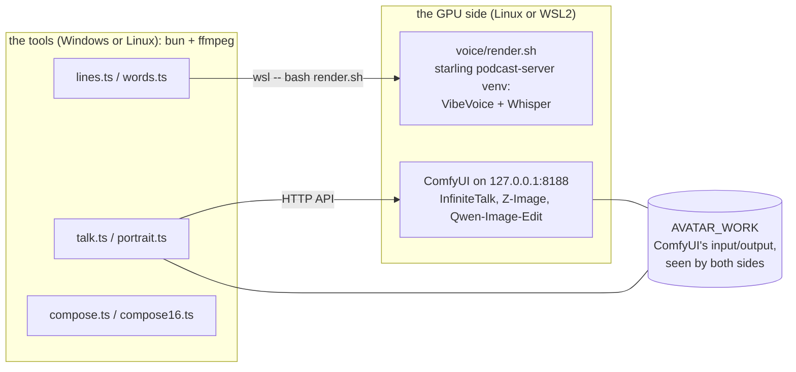

# Setup

The pipeline has two sides:

- **The GPU side** runs on Linux: ComfyUI with the talking-head and image models, and the voice engine
  (VibeVoice plus Whisper). On Windows, that is WSL2.
- **The tools** are bun scripts. They run on Windows (and reach the GPU side through `wsl`) or on the
  same Linux machine. They call ffmpeg for every picture and sound operation.



Tested on Windows 11 with WSL2 (Ubuntu 24.04), an RTX 5090 Laptop GPU (24 GB) and 94 GB of RAM. Plain
Linux uses the same commands without `wsl --`; the tools detect it, but that path has not had a full
run yet.

## 1. Prerequisites

| | Where | Notes |
|---|---|---|
| NVIDIA driver | Windows (for WSL2) or Linux | new enough for CUDA 12.8+ wheels; RTX 50xx needs it |
| WSL2 with Ubuntu 22.04/24.04 | Windows | give it at least 32 GB of RAM in `.wslconfig` (`memory=`) |
| git, python3 (3.10+) with venv, curl | the GPU side | `sudo apt install git python3-venv curl` |
| ffmpeg with libass and libx264 | where the tools run | Windows: the gyan.dev "full" build; Linux: `apt install ffmpeg` |
| [bun](https://bun.sh) 1.1+ | where the tools run | `powershell -c "irm bun.sh/install.ps1 \| iex"` or `curl -fsSL https://bun.sh/install \| bash` |
| [Claude Code](https://docs.claude.com/en/docs/claude-code) | where the tools run | run `claude` once and log in (a Claude plan or an API key); the plan step calls `claude -p` |
| tesseract-ocr | the GPU side | optional, for `tools/check.ts --deny` |

About 75 GB of free disk on the Linux side: 54 GB of model weights (84 GB with the optional `edit` set), 12 GB for the voice engine, 8 GB
for the ComfyUI venv.

## 2. Clone

```bash
git clone https://github.com/gjovanov/roomler-ai-avatar
cd roomler-ai-avatar
bun test tools        # the pure parts: segments, word times, captions
```

On Windows, clone it where both sides can reach it (any folder on `C:` is `/mnt/c/...` in WSL). The
commands below run from the repository's root; on Windows, prefix the `bash` ones with `wsl --`.

## 3. Settings

Everything has a default. To change one, set it in the environment, or, for the scripts on the Linux side,
in `~/.config/roomler-avatar/env` (one `KEY=value` per line). Under WSL use that file: Windows
environment variables do not reach WSL.

| Setting | Default | Meaning |
|---|---|---|
| `AVATAR_HOME` | `~/roomler-avatar` | ComfyUI, its node packs and its venv (Linux side) |
| `AVATAR_MODELS` | `$AVATAR_HOME/models` | the model weights, 54-84 GB (Linux side; keep them on ext4) |
| `AVATAR_TORCH_INDEX` | the cu130 wheel index | PyTorch's CUDA build; cu128 for older drivers |
| `STARLING_PODCAST_DIR` | `~/starling/apps/podcast-server` | the voice engine (Linux side) |
| `AVATAR_VOICES_DIR` | the engine's own voices | your own voice prompts, e.g. a consented clone (Linux side) |
| `AVATAR_WORK` | `~/roomler-avatar-work` (under WSL: `%USERPROFILE%\roomler-avatar-work`) | ComfyUI's input and output; both sides must see the same folder |
| `AVATAR_PRESENTERS` | `presenters/presenters.json` | the presenters registry |
| `AVATAR_PRIVATE` | `~/roomler-avatar-private` | real people's portraits, kept out of every repository |
| `AVATAR_MIN_FREE_MB` | `6000` | a render stops when the host has less memory available than this |
| `AVATAR_FONT_FILE`, `AVATAR_CAPTION_FONT` | Segoe UI (Windows), DejaVu Sans (Linux) | the fonts of the labels, cards and captions |

## 4. ComfyUI and the models

```bash
bash tools/avatar/setup.sh base                     # ComfyUI + 3 node packs + venv, pinned to versions.lock
bash tools/avatar/setup.sh models wan infinitetalk portrait   # 54 GB: the talking heads + invented faces
bash tools/avatar/setup.sh models edit              # optional, ~30 GB: a portrait from your own photo
bash tools/avatar/setup.sh doctor                   # checks GPU, torch, node packs, every model file
```

`base` takes 10-20 minutes and pins `transformers==4.57.6` with `diffusers==0.35.2`: under transformers
5.x, InfiniteTalk's wav2vec2 features come back empty (`'NoneType' object is not subscriptable`).

⚠️ **Keep the weights on the Linux filesystem.** Under WSL, `/mnt/c` is read through the 9p bridge at
25-40 MB/s, and the talking-clip model (16.6 GB) is re-read for every clip: 12-20 minutes a clip from
`/mnt/c`, 7 seconds from ext4. If the weights must live on a Windows drive, run
`setup.sh localize infinitetalk` to copy the hot files into ComfyUI's own folder.

## 5. The voice engine

The voices come from VibeVoice-1.5B through [starling](https://github.com/gjovanov/starling)'s
podcast-server, which also carries Whisper for the word timing:

```bash
git clone https://github.com/gjovanov/starling ~/starling
cd ~/starling/apps/podcast-server && ./init.sh      # venv + torch + transformers + the model (~5.4 GB)
```

Its two built-in voices, `michael` and `emma`, are the presenters' voices here. Check that the tools
find them:

```bash
bash tools/voice/render.sh voices                   # michael, emma
```

Read the podcast-server's README before you publish anything it renders: VibeVoice's model card states a
research purpose and asks for disclosure.

## 6. Start the server

```bash
bash tools/avatar/comfy-server.sh start             # loopback only: ComfyUI has no authentication
bash tools/avatar/comfy-server.sh status
bash tools/avatar/comfy-server.sh log 40
bash tools/avatar/comfy-server.sh stop              # when you are done: it holds the GPU
```

The server runs in a memory-capped systemd scope (26 GB, no swap) when WSL's systemd user manager is
available, so an overreach kills ComfyUI and nothing else. It starts with `--cache-classic`: the default
cache evicts the loaded model whenever free RAM is under 10%, which in WSL is most of the time.

Under WSL, the tools on Windows reach `127.0.0.1:8188` through WSL's localhost forwarding (on by
default) or mirrored networking.

## 7. Check it end to end

[example/README.md](../example/README.md) makes a 20-second video in both formats, and touches every
part of the setup on the way.
